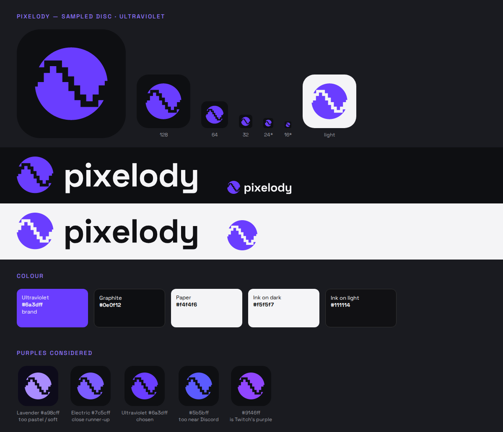

# The Pixelody mark

The shipped mark is Sampled Disc (A), with the W1 wordmark and Ultraviolet brand color. It appears on desktop builds/windows/taskbar and Android launcher/splash, including adaptive and themed-icon layers.

A stepped sine wave cuts through the disc. The cut is actual negative space, so it works over different backgrounds. Both halves match after a 180° rotation. Generate the geometry rather than editing individual paths.

## Geometry and color

| Part | Geometry |
| --- | --- |

| Disc | circle centred `12,12`, r 8 |
| Wave | one sine cycle over x 4→20, sampled at 12 points (`sin(2π(i+½)/12)`), amplitude 4.5, heights snapped to 0.5 units, entering and leaving at y 12 |

Only the mark carries brand color; the wordmark stays neutral. Don't add gradients, pair the purple with pink, rotate the mark, outline it or fill the wave cut. Leave one-quarter disc diameter clear on every side. Use the coarse small icon at 24px and below, and keep a lockup at least 20px high.

The lowercase wordmark uses outlined Space Grotesk Bold, weight 700, tracking −20/1000. In the lockup, the disc is 1.56 times cap height, centered on it with a 0.42-cap-height gap. The bundled OFL font record is in [the asset notice](../../THIRD_PARTY_ASSETS.md).

## Logo color controls

| Cut | wave stroked 1.25 wide with square joins and subtracted from the disc; slivers under 2 square units are dropped |
| Small cut (16–24 px) | 8 samples, cut 1.7 wide, so the steps survive tiny sizes |

Desktop Settings → Style → Logo color changes the in-app mark and running icon. Studio uses the saved purple; another theme can use its accent unless recoloring is disabled. An explicit color applies/saves immediately; a later explicit theme selection can resume theme following, and returning to Studio restores the saved purple.

On Android, Settings & Themes → Logo color follows the effective theme/palette by default. Six authored themes and nine presets have generated launcher colors. Arbitrary colors use the nearest baked shade for the launcher and exact color in-app. Studio's Home image supplies a stable Custom accent; changing pages doesn't change the alias. An explicit purple overrides following, and enabling following retains that manual choice. Older manual preferences stay manual. One of twenty aliases is enabled without stopping playback; wallpaper themes/icon packs may still alter the visible launcher icon.

## Windows icon updates

The running icon uses generated mark pixels; installer/executable resources retain their baked colors. Matching shortcuts can be updated, but unrelated shortcuts and native-helper identity stay untouched. The helper matches target/app ID/arguments, backs originals up under `brand-icons/shortcut-backups`, and revalidates cached matches. Separate profiles use stable profile-derived taskbar IDs and require exact profile arguments, so a preview doesn't modify the owner's shortcut.

Per-color ICO files live under the profile's `brand-icons`. Relaunch/icon properties are set before the AppUserModel.ID refresh; separate calls avoid Electron's combined-call ordering. Requests serialize and cache only successful acknowledgments. After a settled change, the worker follows Chromium's association/item refresh pattern for matching links and exits with the app. The Shell can briefly redraw.

Animated changes save window properties, temporarily suppress relaunch-icon resolution with PreventPinning and use live setIcon frames. They restore canonical identity/pinning and final shortcut color on completion, or roll back on failure/cancel. There are 66 eased frames over about 1.1 seconds, with a 150ms removal pause at the initial taskbar refresh. Startup, unchanged colors, reduced motion and disabled reactions use the immediate path. Matching-shortcut notifications finish a successful native animation; immediate/fallback updates use a full refresh.

Recorded tests covered Studio/Cartridge Quest/Obsession transitions after the removal pause and a Search-launch regression, plus manual colors and disabled-motion updates in an isolated profile. Those are dated implementation observations, not a check of every Windows Shell configuration. The refresh reference is [Chromium's shortcut implementation](https://raw.githubusercontent.com/chromium/chromium/main/chrome/browser/profiles/profile_shortcut_manager_win.cc).

## Regenerating assets

Use `tools/brand/generate_brand_assets.py` (shapely/fonttools), then `tools/brand/render_brand_pngs.js`. A color change must agree across LOGO_COLORS, `src/brand-mark.js`, generated `tools/brand/logo-colors.json`, Android `PixelodyLogoColor.kt`, Settings swatches and manifest aliases. Run the generators and `npm run check`. Windows `scripts/create-release-icon.ps1` can rebuild the 512px package input from the SVG.

| Role | Value | Notes |
| --- | --- | --- |

Generated copies also live in `build/icon.*`, `src/assets/brand/` and Android resources. Android automatic accents use `python tools/brand/generate_brand_assets.py --android-theme-icons-only`; ANDROID_THEME_COLORS, ThemeLauncherIcon and aliases must agree without changing geometry. Desktop's manual five-color list is independent.
